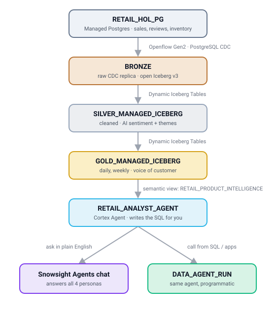

# Ingestion to Insight: An AI-Ready Retail Pipeline with Openflow

Virtual Hands-On Lab.

You run a candle and fragrance brand: 12 scents like *Frosted Juniper*, *Vanilla Cedarlight*
and *Sea Salt Blossom*. They sell online and through 4 regional store networks, shipped from
5 warehouses.

Your sales and reviews live in a Postgres database. Your team wants answers now, not next week.

In about an hour you'll stream that data into Snowflake, enrich it with AI, and put an agent on
top that answers questions in plain English, all without leaving Snowflake.

After a one-time setup script, you build everything by prompting **CoCo (Cortex Code) Desktop**.

<p align="center">
  
</p>

## The story: four people, four tools, zero alignment

| Persona | Asks | Today |
|---|---|---|
| **The Merchandiser** (daily) | "What sold yesterday? Is anything running low?" | Waits for a nightly batch |
| **The VP of Retail** (weekly) | "How did we do? Where are we trending?" | A slide someone built by hand |
| **The CX Lead** (constantly) | "What are customers saying about us right now?" | Reads reviews one at a time |
| **The Supply Chain Planner** | "Which warehouse needs a truck today?" | A spreadsheet export |

Each of them uses a different tool, waits for a different report, and trusts a different copy of the data.

**What you'll build:** one platform, one pipeline, and one agent that answers all four of them. Every
layer runs inside Snowflake under one governance and RBAC model, with no third-party CDC
engine, no data egress, and no ETL glue.

| Act | Title | You'll see |
|---|---|---|
| **Act 1** | *Lay the foundation* | Openflow set up in SQL (started first, ~15 min) |
| **Act 2** | *Open the store* | Postgres loaded with ~10,000 retail rows |
| **Act 3** | *Stream it in* | Postgres streams into Iceberg via CDC |
| **Act 4** | *Watch it flow* | Live connector health on the Openflow dashboard |
| **Act 5** | *Make it make sense* | Silver/Gold tables with built-in AI |
| **Act 6** | *Ask it anything* | An agent answers every persona |
| **Act 7** | *Clean up* | Everything removed |

## What you need

- A **Snowflake event account** (provided to you) with SPCS, Openflow, Snowflake Managed
  Postgres and Cortex AI enabled. You will be ACCOUNTADMIN. The lab checks feature availability
  for you in Act 0.
- **CoCo Desktop** ([download](https://www.snowflake.com/en/product/snowflake-coco/downloads/)).
- **Git** and **Python 3.9+** on your machine (used to load the Postgres data).

## Repo layout

```
README.md                         this file: setup + the full lab story
solutions/                        SQL answer key (00 bootstrap ... 04b observability ... 08 agent, 99 cleanup)
scripts/setup_postgres.py         creates RETAIL_HOL_PG, saves creds to pg_creds.json, creates the secret + egress rule
scripts/load_retail_data.py       generates + loads the retail data into Postgres, creates the CDC publication
scripts/configure_connector.py    creates + configures (config.json) + commits + starts the CDC connector via SQL
scripts/cdc_demo.py               inserts new rows in Postgres and times their arrival in Bronze (live CDC proof)
notebooks/                        the original Snowsight notebooks (reference only)
docs/                             architecture diagram + presenter guide (timing, talk track, troubleshooting)
.snowflake/cortex/skills/openflow-retail-vhol/   the VHOL skill (auto-loads in CoCo)
```

## Setup

### A. Get the lab files

1. Clone the repo. CoCo Desktop will ask for this folder when it launches.
   ```
   git clone https://github.com/sfc-gh-skumar-1/openflow-vhol.git
   cd openflow-vhol
   ```
   (No git? Use **Code -> Download ZIP** and unzip it.)

### B. Bootstrap the account (Snowsight)

2. Log in to your event account in **Snowsight** as the provided admin user (you are ACCOUNTADMIN).

   Run the SQL below in a worksheet (identical to `solutions/00_bootstrap.sql`).

   It's split into two blocks you run one at a time. **Highlight a block and press Cmd/Ctrl+Enter.**

   - **Block 1 (identity + PAT):** creates the lab user `VHOLuser`, its network policy, and its PAT `vhol_pat`.

     **Copy the `token_secret` from the results grid** (shown only once).

     Save it as the **only contents** of a file named `secret.pat` in the **repo root** you cloned in step 1 (gitignored).

     You'll paste this token into the CoCo connection (step 4), and the lab's helper scripts read `secret.pat` to log in as `VHOLuser`.

   - **Block 2 (account identifier):** prints your **`account_identifier`**.

     Copy it; you'll paste it into the CoCo connection (step 4).

   Roles, warehouse, Postgres, Openflow, Iceberg tables and the agent are built later by prompting CoCo (Act 1 onwards).

   ```sql
   -- ===== BLOCK 1: identity + PAT (run this, then copy the PAT into secret.pat) =====
   USE ROLE ACCOUNTADMIN;

   -- Lab user for the CoCo connection and the helper scripts. ACCOUNTADMIN so CoCo can
   -- build the rest of the pipeline (roles, Postgres, Openflow, Iceberg, agent) via prompts.
   CREATE USER IF NOT EXISTS VHOLuser
     DEFAULT_ROLE = ACCOUNTADMIN
     DEFAULT_SECONDARY_ROLES = ('ALL')
     COMMENT = 'Openflow Retail VHOL lab user';
   GRANT ROLE ACCOUNTADMIN TO USER VHOLuser;

   -- PATs require the user to be under a network policy, so open a permissive one (lab only).
   CREATE NETWORK POLICY IF NOT EXISTS vhol_np ALLOWED_IP_LIST = ('0.0.0.0/0');
   ALTER USER VHOLuser SET NETWORK_POLICY = vhol_np;

   ALTER USER VHOLuser
     ADD PROGRAMMATIC ACCESS TOKEN vhol_pat
       ROLE_RESTRICTION = 'ACCOUNTADMIN'
       DAYS_TO_EXPIRY = 7
       COMMENT = 'Openflow Retail VHOL lab token';
   -- >>> Copy the token_secret value now (shown once) into secret.pat. <<<

   -- ===== BLOCK 2: account identifier (run this, then copy the value into CoCo) =====
   SELECT CURRENT_ORGANIZATION_NAME() || '-' || CURRENT_ACCOUNT_NAME() AS account_identifier;
   -- >>> Copy account_identifier (e.g. MYORG-MYACCT). <<<

   -- OPTIONAL teardown (later, from Snowsight as your admin user, NOT from CoCo):
   -- ALTER USER VHOLuser REMOVE PROGRAMMATIC ACCESS TOKEN vhol_pat;  -- revoke just the token
   -- DROP USER IF EXISTS VHOLuser;                                   -- remove the lab user
   -- DROP NETWORK POLICY IF EXISTS vhol_np;                          -- remove its network policy
   ```

### C. Connect CoCo Desktop (as VHOLuser)

3. **Install and launch CoCo Desktop.** When it asks for a project folder, open the repo
   folder you cloned in step 1.
   - Download: https://www.snowflake.com/en/product/snowflake-coco/downloads/
   - Setup/docs: https://docs.snowflake.com/en/user-guide/cortex-code/cortex-code-desktop

   CoCo Desktop is available to all accounts; usage is billed on token consumption, so it
   runs on your event account's credits.
4. **Add the connection.** In CoCo Desktop click **Connections** -> add a new connection:

   | Field | Value |
   |---|---|
   | Account identifier | `account_identifier` from **Block 2** (e.g. `MYORG-MYACCT`) |
   | User | `VHOLuser` |
   | Auth | **Programmatic Access Token** -> paste the token from **Block 1** (no PAT option? pick **Password** and paste it there) |

   Make it the **active** connection.
5. **Pick the model:** the latest Claude Sonnet or Opus, or the latest GPT if Claude isn't listed.

## Run the lab

Each step below is **one prompt** you type into CoCo. The `openflow-retail-vhol` skill makes
sure your objects get exactly the same names and settings as everyone else's. After each
part, CoCo runs a **checkpoint** query and tells you why that step matters.

### Act 0: Ready to build

> Test my Snowflake connection, make sure the openflow-retail-vhol skill is loaded, and run the lab preflight.

CoCo shows your account, user (`VHOLUSER`), role (`ACCOUNTADMIN`) and region. It then checks that
Openflow, Managed Postgres and Cortex AI respond in this account. If the skill isn't loaded, go to
Agent Settings -> Skills -> Local Skills -> **+ Add Local Skill** and pick the repo folder.

---

### Act 1: Lay the foundation (and start the clock)

*An Openflow deployment takes about 15 minutes to become ACTIVE, so you start it first and build
the Postgres source while it provisions.*

> Set up the lab environment: the RETAIL_HOL_ROLE data role, the RETAIL_HOL_WH warehouse, the
> RETAIL_HOL_ADMIN database for secrets and network rules, the RETAIL_HOL_ICEBERG destination
> database on Snowflake-managed Iceberg storage, the Postgres network policy, and the
> RETAIL_HOL_POSTGRES_EAI external access integration.

> Now kick off Openflow: create OPENFLOW_DB.OPENFLOW_SCHEMA, the OPENFLOW_ADMIN role and the
> least-privilege POSTGRES_INGEST_SERVICE_ROLE, the SPCS_SOM Gen2 deployment, and a dedicated
> EVENTS event table attached to it. Don't wait for it to finish.

**Checkpoint D:** `SPCS_SOM` appears in `SHOW OPENFLOW DEPLOYMENTS` while it provisions.

> **Why it matters.** The whole deployment is *infrastructure-as-SQL*: repeatable, reviewable,
> and version-controlled. Before any data moves, admin duties and the connector's identity are
> already separated, so a compromised connector can only affect a single ingest role. Telemetry
> lands in an event table from the first minute.

---

### Act 2: Open the store (the operational source)

*Your store's system of record is a Postgres database. With Snowflake Managed Postgres it runs
in the same account as your analytics.*

> Set up a Python virtual environment for my OS and install scripts/requirements.txt.

> Create the RETAIL_HOL_PG Snowflake Managed Postgres instance for the lab, without showing me
> its password, and wire up the secret and egress rule.

CoCo runs `scripts/setup_postgres.py`, which takes about 5 minutes. It creates the instance and
writes the one-time `snowflake_admin` password straight to `pg_creds.json` (gitignored). Then it
creates the Snowflake secret and points the egress rule at the new host. You'll only ever
see the host and `****` plus the last 4 characters of the password.

> Load the retail data into Postgres and create the CDC publication.

**Checkpoint P:** the loader prints row counts for 5 tables in the `bronze` schema
(`sales_transactions`, `daily_reviews`, `product_reviews`, `customer_comments`, `inventory_feed`,
with JSONB metadata and PostGIS warehouse locations). It also lists the tables in the
`openflow_retail_pub` publication.

> **Why it matters.** OLTP and analytics share one platform and one security perimeter. CDC
> never has to cross clouds or reach an external database.

---

### Act 3: Stream it in (Openflow CDC to Iceberg)

*Check in on Act 1:*

> Is the SPCS_SOM deployment ACTIVE yet?

Once it shows ACTIVE:

> Create the POSTGRES_RUNTIME_SOM Gen2 runtime on SPCS_SOM (medium, one node, running as
> POSTGRES_INGEST_SERVICE_ROLE with the Postgres EAI), plus the suspend/resume cost-control tasks.
> Wait until the runtime is ACTIVE.

Now create the connector. Pick **one** path; both build the same `POSTGRES_INGEST` connector.

#### Option A (default): connector as code, via SQL

> Create the POSTGRES_INGEST PostgreSQL CDC connector with SQL, not the wizard: configure it to
> replicate the bronze schema from RETAIL_HOL_PG into RETAIL_HOL_ICEBERG as Iceberg v3 tables,
> commit the configuration, and start it.

CoCo runs `scripts/configure_connector.py`. The script:
1. Creates the connector from its catalog definition: `CREATE OPENFLOW CONNECTOR ... FROM DEFINITION OPENFLOW_POSTGRES_CDC`.
2. Downloads its live `config.json` and fills in the source URL, a **secret reference** for the
   password, the publication, the 5 tables and the Iceberg destination.
3. Uploads the PostgreSQL JDBC driver next to it.
4. Runs `COMMIT`, then `START`, and prints exactly which keys it changed.

The password never appears in the file. Open `connector/config.json` afterwards to see the
"connector as code" for yourself.

#### Option B: the guided setup wizard (Snowsight)

Prefer clicking through a UI? Ask CoCo for your values first:

> I want to use the Openflow setup wizard instead of SQL. Give me the exact values to enter for the POSTGRES_INGEST connector.

Then in Snowsight:
1. **Ingestion -> Openflow -> Launch Openflow.** Switch your role to **`OPENFLOW_ADMIN`** (top right).
2. Open the **Connector library** tab and find **PostgreSQL CDC** (it's marked **gen 2**). Pick runtime
   **`POSTGRES_RUNTIME_SOM`**, then select **Install** and name it **`POSTGRES_INGEST`**.
   If you're prompted, **Allow** the Openflow data plane to access your account.
3. Fill in each wizard step. Select **Verify** on each step to test it; only the final check has to pass.

   | Step | Field | Value |
   |---|---|---|
   | Source | Source Database Connection URL | `jdbc:postgresql://<your host>:5432/postgres` (host printed by `setup_postgres.py`) |
   | | Source Database Driver | upload `postgresql-42.7.5.jar` from [jdbc.postgresql.org](https://jdbc.postgresql.org/download/) |
   | | Source Database User | `snowflake_admin` |
   | | Source Database Password | secret `RETAIL_HOL_ADMIN.SECRETS.RETAIL_HOL_PG_PASSWORD` |
   | | Publication Name | `openflow_retail_pub` |
   | Replication tables | | **Manual**: tick only schema `bronze` (all 5 tables); untick `public` |
   | Replication columns | | keep all columns; leave "include newly added columns" on |
   | Destination | Destination Database | `RETAIL_HOL_ICEBERG` |
   | | Warehouse | `RETAIL_HOL_WH` |
   | | Destination Schema Strategy | keep the source schema name (lands in `BRONZE`) |
   | | Object Identifier Resolution | Case Insensitive |
   | | Oversized Value Strategy | Set Null |
   | | Table Storage Format / Iceberg Version | Iceberg / 3 |
   | Tuning, Migration | | keep the defaults (merge every minute; ingestion type Full) |

4. Select **Create Connector**. On **Installed Connectors**, open the connector's menu and select **Start**.

> **Tip:** to change it later, use **Installed Connectors -> Edit**. The runtime canvas is read-only for
> wizard connectors.

> Show me the Bronze Iceberg tables Openflow created, and compare their row counts with Postgres.

**Checkpoint C:** 5 Iceberg tables in `RETAIL_HOL_ICEBERG.BRONZE`, and their counts match the loader.

> **Why it matters.** This is CDC without a third-party engine: the Openflow runtime is
> Snowflake-managed SPCS compute running inside your account. The connector's configuration is
> code (a versioned `config.json` with commit and abort), so you can template it for a whole
> fleet of connectors. Data lands as **open Iceberg** from the very first byte.

---

### Act 4: Watch it flow (Openflow observability)

*The pipeline is live. Now see it the way an operator would.*

> Set up observability for the Openflow pipeline: make sure the dedicated EVENTS event table is
> attached to SPCS_SOM, give RETAIL_HOL_ROLE read access, cluster it for the dashboard, and show me
> whether telemetry is arriving and whether there are any errors or stuck FlowFiles.

CoCo runs `solutions/04b_observability.sql`. Then open the dashboard:

1. **Ingestion -> Openflow -> Connector Observability**.
2. Set **Event table** to `OPENFLOW_DB.OPENFLOW_SCHEMA.EVENTS` and the time frame to **Last Hour**.
3. Find `POSTGRES_INGEST`. You'll see its status (**Healthy**/**Unhealthy**), throughput and data ingested.
4. Open the connector's menu and select **View Details**. Each of the 5 tables shows its **replication phase**
   (New -> Snapshot Load -> Incremental Replication), its status and **Last Ingested**.

Now prove it's live CDC, not a one-time copy:

> Add 5 new sales rows for Frosted Juniper dated today in Postgres, then show me when they land in Bronze.

The new rows show up in `RETAIL_HOL_ICEBERG.BRONZE.SALES_TRANSACTIONS` within about a minute, and
**Last Ingested** moves on the dashboard.

**Checkpoint O:** the connector shows **Healthy**, all 5 tables are in **Incremental Replication**,
the error-log query returns no rows, and the new rows reached Bronze.

> **Why it matters.** Openflow writes its logs and metrics to an event table you own, so health is
> both a dashboard and plain SQL you can alert on. If a connector turns **Unhealthy**, select
> **Troubleshoot** on the dashboard for an AI root-cause analysis built from the same telemetry.

---

### Act 5: Make it make sense (Silver + Gold with built-in AI)

> Build the Silver layer as Dynamic Iceberg Tables: unpivot sales by region, flatten the inventory
> JSON with stock health and warehouse coordinates, and enrich product reviews with Cortex
> sentiment and theme classification.

> Show me the most negative reviews with their AI sentiment score and theme.

> Build the Gold layer: daily product performance, customer voice analytics with AI summaries
> and intent, and a weekly product scorecard, with frozen regions so history isn't re-processed.

**Checkpoints S and G:** 6 Dynamic Iceberg Tables, all `is_iceberg = true` and `ADAPTIVE`, and
the Gold tables have frozen regions (`immutable_where`).

> **Why it matters.** The data stays in an open format with zero setup: Snowflake-managed Iceberg
> needs no external volume, catalog or IAM. **ADAPTIVE** refresh processes only changed rows, and
> **FROZEN WHERE** stops you paying to re-aggregate history. Sentiment, classification and
> summarization run as plain SQL functions inside the pipeline, so there are no external model calls.

---

### Act 6: Ask it anything

> Create the RETAIL_PRODUCT_INTELLIGENCE semantic view over the Gold tables, then the
> RETAIL_ANALYST_AGENT Cortex Agent that uses it.

Now ask the questions from the start of the story:

> Ask the agent, as the Merchandiser: what are the top 3 and bottom 3 products by total units
> sold, with their positive review percentage?

> As the Supply Chain Planner: which products are most overstocked relative to their sales, which
> warehouse city holds them, and where should we rebalance?

> As the CX Lead: which products have the worst customer sentiment, and what are customers complaining about by intent type?

> As the VP of Retail: give me a weekly business review and flag products declining over the last 4 weeks.

Then open **Snowsight -> AI & ML -> Agents -> Retail Analyst Agent** and chat with it directly.
There are 20+ more questions in
`.snowflake/cortex/skills/openflow-retail-vhol/references/agent_spec.md`.

> **Why it matters.** The agent writes the SQL for you. One semantic model serves four personas,
> and a budget caps the cost of every answer. The data it reads is the same open Iceberg data a
> Spark or Trino job could query. Each layer, from an insert into Postgres to a business answer,
> was governed end to end on one platform.

---

### Act 7: Clean up

> Clean up everything this lab created.

CoCo asks you to confirm, then runs `solutions/99_cleanup.sql`. It stops the connector,
terminates the runtime and deployment, and drops the Postgres instance, databases, warehouse
and roles. To remove the `VHOLuser` login, use the teardown block in `00_bootstrap.sql` from
Snowsight. You can't do it from CoCo, because CoCo is logged in as that user.

## How the skill knows all this

You typed plain-English prompts, yet everyone's objects came out identical. That consistency comes
from the **`openflow-retail-vhol` skill** (`.snowflake/cortex/skills/openflow-retail-vhol/`).
CoCo loads it automatically when you open this folder:

- **`SKILL.md`** holds the object model (exact names and settings), the workflow, the checkpoints,
  the secret-handling rules and the "why it matters" lines.
- **`references/object_model.md`** points each part to its verbatim DDL in `solutions/`.
- **`references/connector_config.md`** describes the SQL connector workflow
  (`CREATE OPENFLOW CONNECTOR ... FROM DEFINITION` -> GET/PUT `config.json` -> COMMIT -> START),
  maps each value, and includes a wizard fallback.
- **`references/agent_spec.md`** covers the agent settings and the persona question bank.

### Build your own skill

A skill is a folder containing a `SKILL.md` (YAML front matter with `name` and `description`, then
markdown instructions), plus optional `references/`. Commit it with your repo and it auto-loads
for anyone who opens the project in CoCo Desktop. This skill makes a working template for
encoding your own team's Openflow and pipeline conventions.

## Troubleshooting

| Symptom | Fix |
|---|---|
| Deployment stuck in CREATING | It usually takes ~15 min. If it fails and mentions terms of service, an ORGADMIN must accept the Openflow terms once. |
| Loader can't connect to Postgres | Check that the instance is READY and that `pg_creds.json` has the right host. |
| `setup_postgres.py`: instance exists but pg_creds.json is missing | The one-time password is lost. Drop `RETAIL_HOL_PG` (or reset its `snowflake_admin` credentials) and re-run. |
| Agent says "I've reached the time limit" | The budget is 30 s per answer. Ask a narrower question, or say "continue". |
| Connector commit/validation error | Ask CoCo to read the error, fix the named key in `config.json`, re-upload and commit again. |
| Connector running but Bronze is empty | Ask CoCo to "show recent Openflow errors from the event table". The usual causes are an egress rule still set to the placeholder host, or the secret not granted to `POSTGRES_INGEST_SERVICE_ROLE`. |
| SQL connector config is blocked | Use **Option B (wizard)** in Act 3. Everything else stays the same. |
| Connector missing from the dashboard | Select event table `OPENFLOW_DB.OPENFLOW_SCHEMA.EVENTS` and **Last Hour**. Connectors only appear once they've emitted telemetry in that window. |
| Agent "not an allowed model" | The spec already uses `orchestration: auto`. Pick a model in Snowsight -> Agent -> Configuration. |

## Credits

Adapted from the *AI-Ready Data Pipeline* retail hands-on lab notebooks (in `notebooks/`) for a
prompt-driven, CoCo Desktop format.
